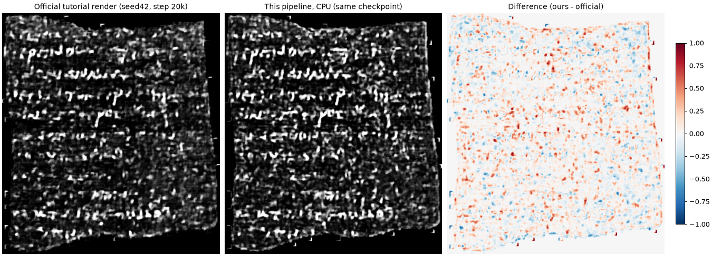
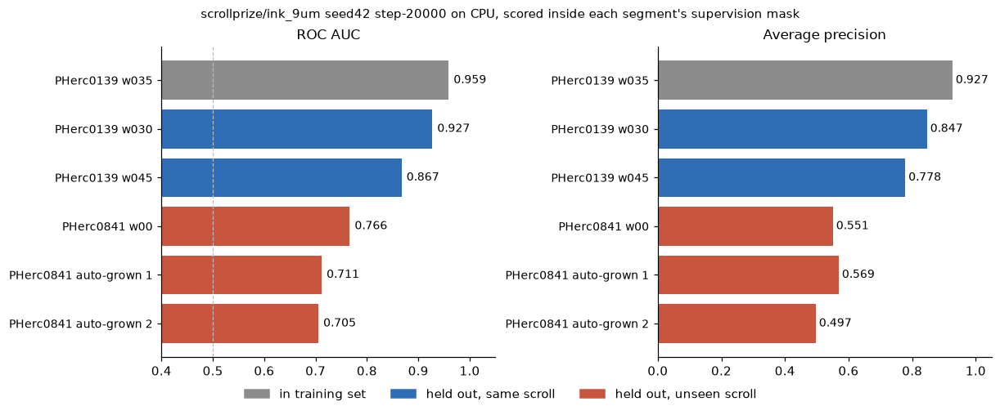
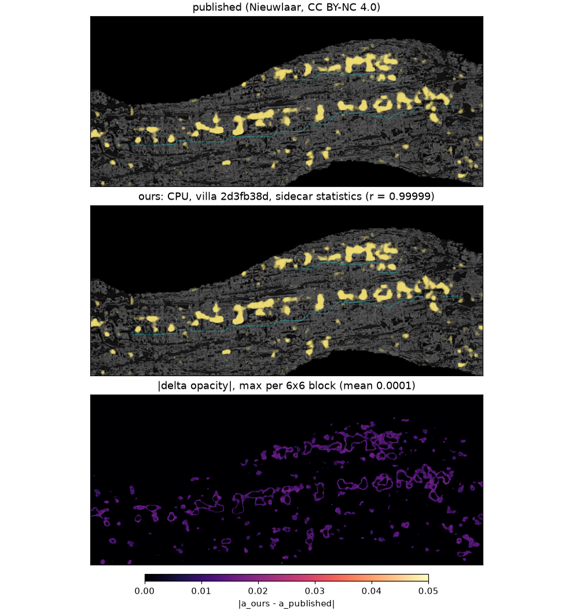
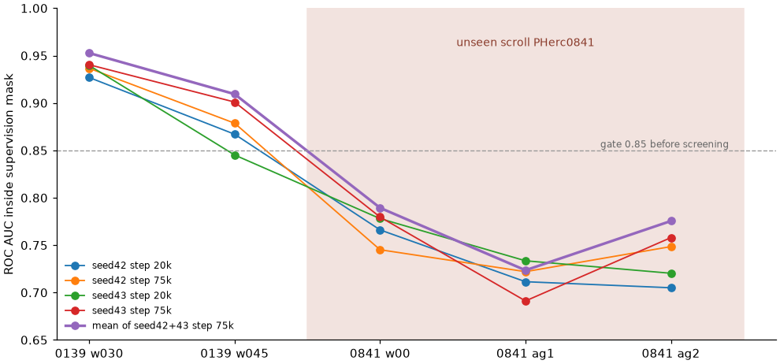
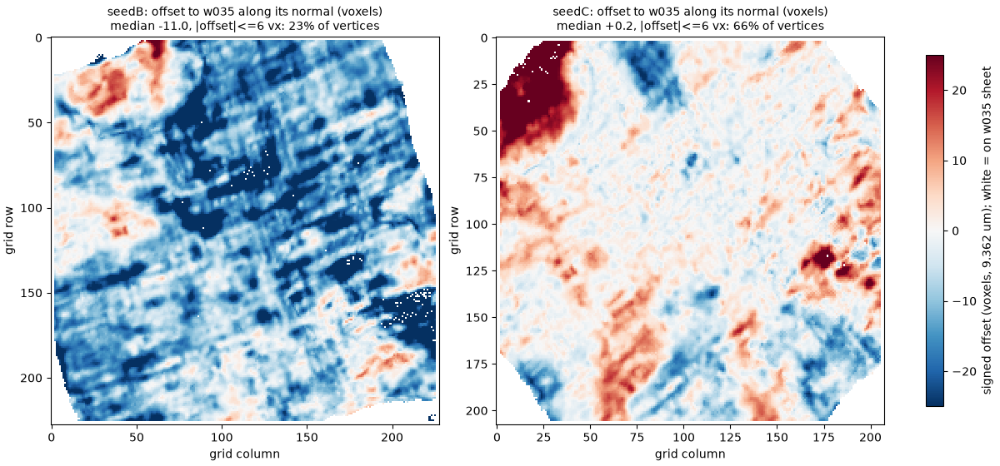

# vesuvius-pipeline

A pinned, headless, **CPU-only** pipeline for the [Vesuvius Challenge](https://scrollprize.org): it takes a
segment's surface geometry (`tifxyz`), streams only the CT chunks it touches from the open-data bucket, renders the
surface volume, runs the public 9 µm ink model, and scores every stage numerically against the published products.

It needs no GPU, no account, and no manual step. One command runs the whole chain in a container:

```bash
podman build -t vpipe:cpu -f docker/Dockerfile.cpu .      # CPU-only torch, 13.3 GB
IMAGE=vpipe:cpu scripts/run_w035.sh                        # fetch -> render -> ink -> metrics, runs/w035-<timestamp>/
```

`docker/Dockerfile` builds the same environment with villa's locked CUDA torch (21.4 GB); on CPU both give
byte-identical ink images.

## Results on PHerc. 0139 segment w035 (reference run, 2026-11-16)

Hardware: one 16-vCPU / 62 GB VM, no GPU. Every number below comes from a file in [`results/`](results/).

| Stage | Compared with | Result |
|---|---|---|
| Render (`vc_render_tifxyz`, S3 stream, 28 slices) | published 9.362 µm surface volume, 28 × 5820 × 5240 voxels | **99.73 % voxels identical, 100 % within 1 grey level**, Pearson r ≥ 0.9999994 per layer |
| Ink (`scrollprize/ink_9um` seed42 step-20000) | published 9.362 µm ink labels, inside the supervision mask (1,071,121 px) | **ROC AUC 0.959, AP 0.927, best F0.5 0.881** (precision 0.935, recall 0.714 at threshold 159) |
| Ink | official tutorial image of the same checkpoint on w035 | Pearson r 0.806 (Spearman 0.823); same letters, see below |

End-to-end, one command, inside the container, cold chunk cache
([`results/w035-e2e-1/`](results/w035-e2e-1/)):

| Stage | Wall time |
|---|---|
| Fetch geometry + reference products | 7 s |
| Render (streams 10.9 GB of 128³ chunks for a 0.9 GB output) | 11 min 28 s |
| Ink inference, full segment, CPU | 7 min 50 s |
| Evaluation | 1 min 4 s |
| **Total** | **20 min 29 s** |

The ink image of this run is byte-identical to an earlier, separate run: the chain is deterministic on CPU.
Peak RAM: 5.9 GB (render), 2.1 GB (inference).



## Held-out segments: how well the public 9 µm model transfers

w035 is in the model's training set, so we also ran five labelled segments that are **not** in it (the training
list is the `ink_9um/labels` folder of the `scrollprize/datasets` bucket). Their labels live on the 2.4 µm grid; they
are resized onto our ~9.4 µm grid and aligned from CT texture alone (`vpipe.align`), so the ink model never affects
how it is scored. Table generated by `scripts/make_results.py` from [`results/`](results/).

<!-- results:heldout:start -->
| Segment | Set | Scored px | ROC AUC | AP | best F0.5 | Label grid → ours (dy, dx) | Render identical / within 1 |
|---|---|---|---|---|---|---|---|
| PHerc0139 w035 | in training set | 1,071,121 | 0.959 | 0.927 | 0.881 | native 9 µm | 99.73 % / 100 % |
| PHerc0139 w030 | held out, same scroll | 801,060 | 0.927 | 0.847 | 0.798 | (-8, -8) r=0.78 | 99.75 % / 100 % |
| PHerc0139 w045 | held out, same scroll | 578,688 | 0.867 | 0.778 | 0.750 | (-8, -8) r=0.78 | 99.75 % / 100 % |
| PHerc0841 w00 | held out, unseen scroll | 1,600,018 | 0.766 | 0.551 | 0.546 | (-7, -7) r=0.74 | 99.57 % / 100 % |
| PHerc0841 auto-grown 1 | held out, unseen scroll | 983,597 | 0.711 | 0.569 | 0.549 | (-7, -7) r=0.74 | 99.60 % / 100 % |
| PHerc0841 auto-grown 2 | held out, unseen scroll | 1,279,092 | 0.705 | 0.497 | 0.515 | (-7, -7) r=0.75 | 99.57 % / 100 % |
<!-- results:heldout:end -->



- On new segments of a training scroll (PHerc0139) the model holds up: AUC 0.87-0.93.
- On a scroll it never saw (PHerc0841) it drops to AUC 0.71-0.77 and AP 0.50-0.57. Cross-scroll transfer is the
  weak link, which is exactly the First Letters setting (unread scrolls, no labels).
- A random predictor scores AUC 0.5 and AP equal to the ink fraction (0.22-0.32 here), so all segments are well
  above chance.
- Caveats: one checkpoint (seed42, step 20000); labels are the published ones and may themselves come from
  model-assisted annotation; five segments are a small sample.

## Reproducing a First Letters result: PHerc. 343 render, bit for bit

The October 2026 First Letters image of PHerc. 343 (Erwin Nieuwlaar, MIT, `github.com/Nieuwlaar/pherc343-first-letters`
at `e8370f1`) was rendered with a VC3D build that can no longer be downloaded (ScrollPrize/villa#2049).
`scripts/m6_render_343.sh` verifies the published mesh against its `SHA256SUMS` (16/16 OK), streams the 8.640 um
PHerc0343 volume and renders it headless on CPU with VC3D `f7756c7` and the author's flags (66 layers, step 1).

| Check (author's sidecar) | Ours |
|---|---|
| sha256 of decoded layer 34 over the submission area (rows 105..2560, cols 380..6021) | `df1a3e8d...` **identical** |
| sha256 of the packed valid mask (all 66 layers > 0) | `f6054921...` **identical** |
| valid fraction of the area | 0.6418 (sidecar 0.6418) |
| render wall time, 66 x 2560 x 6720 | 11 min 30 s (peak RAM 2.8 GB) |

So the render step of that result is reproducible with a current, downloadable VC3D build. (AndreasHad04 had
already reproduced the image with his own CPU renderer, r 0.99983, in villa#2049; this run uses the official tools.)

**Ink step, CPU only.** `scripts/m6_ink_343.sh` runs the author's four models (ink_9um seed42 and seed43 at step
75k, Hecate 9.6 um, his dense_native fine-tune rebuilt from the public safetensors; every sha256 checked against his
`models.tsv`) on the plain and the 40 x 200-px padded render at depth d = +1, merges the two tilings with his
`merge_tile_phase.py` and builds the image with his `make_submission_image.py`, using the ensemble statistics from his
sidecar (Arm A: no 31-depth sweep). Scored with `scripts/m6_score_343.py` on ink opacity a = (R - B) / 135
([`results/m6-pherc343/ink_metrics.json`](results/m6-pherc343/ink_metrics.json)):

| Check | Result |
|---|---|
| Pearson r of ink opacity over the data panel (target >= 0.999) | **0.99999** (0.9999855) |
| Pearson r inside the 18 letter boxes | 0.99999 |
| Letter boxes with ink fraction within 0.8-1.25 of the published | **18 / 18** (ratios 0.999-1.000) |
| PNG byte-identical | no (expected: different villa commit and CPU numerics) |



CPU time on the 16-vCPU VM: villa models 221-237 s per map when running alone; Hecate 11,624 s (plain) and 3,939 s
(padded) - the slow part on CPU. Not tested: the author's villa commit `0fb38c45` (we used `2d3fb38d`), running
`--direction both` instead of the reading side only, and the d = 0 / d = +2 depth controls.

## Checkpoint bake-off on the held-out segments

`scripts/bakeoff.sh` re-scores public `scrollprize/ink_9um` checkpoints and a mean ensemble on the five held-out
renders, without re-rendering (table generated by `scripts/make_bakeoff.py` from [`results/bakeoff/`](results/bakeoff/)).

<!-- results:bakeoff:start -->
| Checkpoint | 0139 w030 | 0139 w045 | 0841 w00 | 0841 ag1 | 0841 ag2 | mean, unseen scroll (0841) |
|---|---|---|---|---|---|---|
| seed42 step 20k | 0.927 | 0.867 | 0.766 | 0.711 | 0.705 | 0.728 |
| seed42 step 75k | 0.937 | 0.879 | 0.745 | 0.722 | 0.748 | 0.739 |
| seed43 step 20k | 0.940 | 0.845 | 0.778 | 0.733 | 0.720 | 0.744 |
| seed43 step 75k | 0.940 | 0.901 | 0.780 | 0.691 | 0.758 | 0.743 |
| mean of seed42+43 step 75k | 0.953 | 0.909 | 0.789 | 0.724 | 0.775 | 0.763 |
<!-- results:bakeoff:end -->



- The mean of the two step-75k seeds is the best or tied-best on four of five segments; on the unseen scroll its
  mean AUC is 0.763 against 0.728-0.744 for single checkpoints.
- No public 9 um checkpoint or this simple ensemble comes near AUC 0.85 on PHerc0841, the gate we set before
  screening unread scrolls. The First Letters winners used other models (Hecate, Reader V3, TRACE v3B, fine-tunes);
  those are the next candidates for this table.
- Run times: with three torch containers sharing 16 vCPUs, one inference took 1575 s; alone, the same kind of run took
  229 s. Runners now take `VPIPE_THREADS` to cap OpenMP/MKL threads per container.

## Automatic surface tracing on CPU (in progress)

`scripts/grow_seed.sh` grows a surface with VC3D's tracer on the organisers' published m7 surface prediction for
PHerc0139, streaming prediction chunks and normal grids, on one CPU thread. `vpipe.surface_compare` scores the
result against the published w035 mesh ([`results/m7-w035-seed*/`](results/)).

| Seed | Placement | Area | Time | Median offset along w035 normal | Vertices within 6 voxels of w035 |
|---|---|---|---|---|---|
| B | w035 centre vertex, as given | 17.5 cm2 | 30 min | -11.2 voxels (adjacent wrap) | 22 % |
| C | first m7-positive voxel along w035's normal, grid centre | 14.4 cm2 | 13 min | +0.07 voxels (w035's sheet) | 65 % |
| D | same rule, 30 % of the grid | 7.4 cm2 | 6 min | -12.6 voxels (adjacent wrap) | 20 % |
| E | same rule, 70 % of the grid | 7.2 cm2 | 5 min | +9.4 voxels (adjacent wrap) | 31 % |

Along w035's normals the m7 prediction shows w035's band at 0..+2 voxels and neighbouring wraps at about -10 and
+13, so sheets here are ~110 um apart and a few-voxel seed error lands on the next wrap. Seed C stays on the sheet
except for contiguous jumped regions (red/blue below), which is what an automatic sheet-switch detector has to find.
Seeds D and E started on w035's band too and still ended up mostly on a neighbouring wrap, so a correct seed is not
enough: the tracer must be kept on its wrap, or its jumps found and cut.

Two reference-free signals were measured against w035 ([`results/m7-consensus/`](results/m7-consensus/)):

- **Agreement between runs** (`vpipe.consensus`, tolerance 4 voxels): vertices that another run passes close to are
  on w035's sheet 70 % (C), 75 % (D) and 64 % (E) of the time, against base rates of 66 %, 21 % and 31 %. It filters
  bad runs well but keeps only ~17 % of each surface, and runs that make the same jump agree with each other.
- **Radius around the scroll's umbilicus.** The published umbilicus (2.4 um volume) was mapped onto the 9.362 um
  volume with an affine fitted on w035's two meshes (median residual 1.3 voxels). A vertex's radius minus w035's
  radius at the same place tracks the true offset with r = 0.93-0.96, so wrap jumps are visible in umbilicus
  coordinates; turning that into a detector without any reference mesh needs a spiral model (next step).

**Ink on the grown surfaces: no letters yet.** Seeds B and C rendered and inked in both depth directions show no
text. The grown surfaces are as smooth as w035 (median second-difference 0.42-0.44 voxels), but only 13 % of seed
C's vertices are within 2 voxels of w035: the rest wander 2-15 voxels, and the papyrus is only ~6 voxels thick here
(w035 sits on the CT intensity peak: mean profile maximum at offset 0, next wrap ~16 voxels out). `vpipe.refine`
(snap each vertex to the CT maximum within +-5 voxels along its normal) moves w035 by a median 0.00 voxels, as it
should, but cannot fix seed C: in its central patch the mean CT profile along the grown normals has no peak (the
surface sits in the gap between two sheets, median 5.9 voxels from w035), and the shifts it finds do not correlate
with the shifts needed (r -0.08). A surface half a wrap off cannot be pulled back from CT alone; the tracer itself has
to stay on the sheet, e.g. on a sharper (2.4 um) surface prediction or with a CT term in its energy.



**Wrap drift, measured.** Across four reference cases (PHerc. 343 next to the First Letters text, and three w035 seeds)
CPU tracing on the published 9 um m7 prediction keeps only 4-13 % of its vertices within 2 voxels of the written sheet;
three of the four drift a full wrap (median offset 9-13 voxels). Two local fixes (CT-peak refinement, wrap-consistent
band snapping) do not help, because neighbouring sheets are connected in the 9 um prediction itself. Details, numbers
and what this implies: [docs/wrap-drift.md](docs/wrap-drift.md).

**What these numbers do and do not show**

- w035 is in the training set of the `ink_9um` models, so the label metrics are a reproduction check, **not** a
  held-out score.
- The render is reproduced essentially bit for bit. The ink image shows the same letters as the official tutorial
  image, but not pixel for pixel (r 0.81). Alignment is exact (best shift 0, 0), the display rescale does not explain
  it, and `--amp-dtype bf16` changes nothing on CPU. The checkpoint is ruled out: the tutorial's command line uses
  step-075000, but the w035 image it shows is captioned "both at checkpoint step-020000", the checkpoint run here.
  The cause is **not identified yet**; candidates are GPU vs CPU numerics and a different inference configuration
  behind the published image.

## Kaggle kernels

`kaggle/` holds GPU/CPU jobs run as Kaggle kernels. Their outputs stay in the (private) kernel runs; only what is in
[`results/`](results/) is reported here.

| Folder | What it does |
|---|---|
| `kaggle/hecate_heldout.ipynb` (`make_hecate_notebook.py`) | Hecate 9.6 µm on held-out PHerc0841 segments, scored like `scripts/bakeoff_hecate.sh`; the notebook is generated by the script |
| `kaggle/hecate_sweep/` | Hecate depth-convention sweep (z-centre, both directions) on held-out PHerc0841 windows, scored with the repo metric |
| `kaggle/hecate_0800/` | Hecate on the six official PHerc0800 segments from the published surface volumes, both depth directions |
| `kaggle/lead_screen/` | trace -> render -> Hecate on First Letters survey leads, plus a PHerc 343 positive control |
| `kaggle/studio_306b/` | Studio (PHerc0211 First Letters model) on the published PHerc0306B claim render, compared with the 306B claim map |
| `kaggle/studio_speed/` | Studio fp32 vs fp16/bf16 and stride 64 vs 96 on a PHerc0306B claim crop: speed and agreement |
| `kaggle/studio_0800band/` | Studio on the 40 snapped windings of PHerc0800 z 5700-7200 (public renders), both depth orders |
| `kaggle/lane_0490a/` | PHerc0490A z 7000-7750 spiral fit + snap on a T4 (vendored pod lane, MIT) |
| `kaggle/flatten_0490a/` | flattens the snapped PHerc0490A windings from `lane_0490a` (vendored, MIT) |
| `kaggle/render_0490a/part0..3` | 31-layer surface volumes of the flattened PHerc0490A windings, four parts (vendored, MIT) |
| `kaggle/studio_0490a/` | Studio on the PHerc0490A windings rendered by `render_0490a`, both depth orders |
| `kaggle/lane_0358/` | PHerc0358 z 7000-7750 spiral fit + snap on 2x T4 with the official umbilicus and lasagna (vendored pod lane, MIT) |
| `kaggle/flatten_0358/` | flattens the snapped PHerc0358 windings from `lane_0358` (vendored, MIT) |
| `kaggle/render_0358/part0..3` | 31-layer surface volumes of the flattened PHerc0358 windings, four parts (vendored, MIT) |
| `kaggle/herculex_0358/` | whole-scroll unwrap of PHerc0358 (CT -> sheet nodes -> exact winding levels -> laid-out tifxyz pieces) with HerculeX's cuda lane on 2x T4 (HerculeX @ 9f59e966, MIT); ink off by default; resumable across sessions |
| `kaggle/herculex_ink_0358/` | HerculeX's ink stage (Reader v3, MIT) on the 263 display mosaics of >= 4 cm2 of `herculex_0358`, largest first on both T4s, then 384 px window triage (row/column ink-profile std) with contact sheets; resumable |
| `kaggle/inksdk/` (`lane.py`, `make_script.py`) | ink stage on 2x T4 with [ink-sdk](https://github.com/LimeGS/ink-sdk) (MIT): Reader V3, Argus V2, TRACE v3B, Studio, A-hn, both depth directions; z-score mean, TRACE v3B x A-hn and Studio x Reader V3 ensembles; window triage. `306b/` is the positive control on the PHerc0306B claim render, `0358/` runs on the `render_0358` windings |

Each folder has a `kernel-metadata.json` with the placeholder owner `KAGGLE_USER`. Push one with your account:

```bash
KAGGLE_USER=<your kaggle username> kaggle/push.sh kaggle/<kernel-dir>
```

`push.sh` fills in the owner in a temporary copy and runs `kaggle kernels push` (via `uvx`, needs a Kaggle API token).

## Layout

| Path | What |
|---|---|
| `scripts/fetch_w035.sh` | anonymous S3 fetch of the w035 reference set (~1.1 GB) |
| `scripts/get_vc3d.sh` | pinned VC3D AppImage, extracted, headless (host libs per villa#2153) |
| `scripts/render_w035.sh`, `scripts/run_w035.sh` | render stage; full end-to-end runner |
| `scripts/run_segment.sh` | any segment end to end (labels on the 2.4 µm grid, aligned from CT texture) |
| `docker/Dockerfile` | Ubuntu 24.04 + villa `2d3fb38d` + VC3D `f7756c7` + vpipe (villa's lock: CUDA torch) |
| `docker/Dockerfile.cpu`, `docker/torch-cpu.txt` | same image with CPU-only torch 2.12.1 / torchvision 0.27.1 |
| `src/vpipe/compare.py`, `evaluate.py`, `align.py` | metrics (voxel agreement, AUC/AP/F0.5, alignment) with unit tests |
| `scripts/grow_seed.sh`, `src/vpipe/surface_compare.py` | CPU tracer on the published m7 prediction; geometry scoring vs a reference mesh |
| `src/vpipe/consensus.py` | trust map from agreement between independent tracer runs |
| `scripts/bakeoff.sh` | score checkpoints / ensembles on held-out renders without re-rendering |
| `scripts/render_ink_surface.sh` | render any tifxyz and run ink in both depth directions |
| `scripts/vjob.sh` | run long jobs as transient systemd units (survive ssh/tmux) |
| `scripts/make_results.py` | regenerate README tables and figures from `results/` |
| `.github/workflows/ci.yml` | unit tests (uv, Python 3.12) and shellcheck on every push / PR |
| `docs/` | prize rules, data inventory, prior work, open problems, plan |

## Notes for reproducing

- Clean `ubuntu:24.04` needs `libssl-dev` to build `vc-object-store`; it is missing from villa's CI apt list.
- Podman with storage on a non-default path under SELinux needs
  `semanage fcontext -a -e /var/lib/containers <path> && restorecon -R <path>`.
- Containers need `--shm-size 8g` (or more) for the inference data loader.

### CPU-only image

villa's `uv.lock` pins torch 2.12.1 from PyPI, which on Linux is the CUDA 13 build and pulls triton plus 18 CUDA /
NVIDIA runtime wheels that a CPU run never loads (130 vs 109 packages in a `uv sync --dry-run` for x86_64 Linux). `docker/Dockerfile.cpu` is identical to `docker/Dockerfile` except for one step:
it runs `uv sync --extra models --frozen` with `--no-install-package` for torch, torchvision, triton and every
`cuda-*` / `nvidia-*` package in the lock, then installs the hash-pinned `torch==2.12.1+cpu` and
`torchvision==0.27.1+cpu` wheels from `https://download.pytorch.org/whl/cpu` (`docker/torch-cpu.txt`). The build
fails if those versions differ from the lock or if any CUDA package is left in the env.

```bash
podman build -t vpipe:cpu -f docker/Dockerfile.cpu .     # or: docker build ...
IMAGE=vpipe:cpu scripts/run_segment.sh ...
```

When bumping `VILLA_REF`, update `docker/torch-cpu.txt` to the lock's torch / torchvision versions (hashes from the
index pages). Inside the image use `uv run --no-sync`; a plain `uv sync` would put the CUDA wheels back.
`tests/test_docker.py` keeps the base image, apt list and pinned ARGs of both Dockerfiles identical.

### Evaluation speed

`vpipe.evaluate ink --align-ref/--align-ours` reads each surface-volume chunk once (published 2.4 µm volumes are
chunked 109 × 128 × 128, so a slice-by-slice depth mean decoded every chunk 109 times) and scores all 31 × 31
alignment shifts at once with an FFT-based masked correlation. On a synthetic 5800 × 5200 segment this takes
~2.5 s each instead of 30 s and 36 s (Apple M4 Pro), with the same shift; the old brute-force search is kept as
`align.texture_shift_bruteforce` and the unit tests check both agree.

## Licence

MIT. Data: CC BY-NC 4.0 (new scans) / EduceLab Data License (legacy scans); see `docs/data-inventory.md`.

---

<p align="center">
  <sub>Powered by</sub><br>
  <a href="https://github.com/bristleconelab">
    <picture>
      <source media="(prefers-color-scheme: dark)" srcset="docs/img/brand/bristleconelab-horizontal-on-dark.svg">
      
    </picture>
  </a>
</p>
